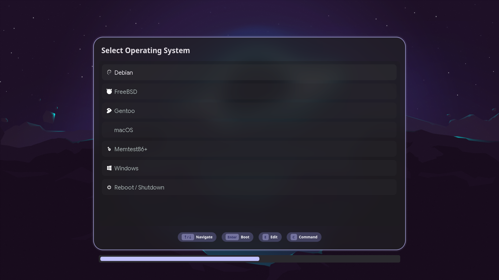

# Dux GRUB Theme

A dynamic GRUB2 theme (fork of [Caelestia-Grub](https://github.com/dim-ghub/Caelestia-Grub)) that follows your **Dux Shell** wallpaper and matugen colour scheme on Fedora.



## Dux Shell Integration

### How it works
- **Wallpaper**: read via Dux Shell IPC — `dms ipc call wallpaper get` (no swww/hyprpaper).
- **Colours**: Dux Shell's own matugen run renders `matugen/dux-grub-colors.conf` (registered in `~/.config/matugen/dms/configs/dux-grub.toml`) to `~/.config/matugen/dux-grub/colors.conf`. Fallback: `~/.cache/dms/dms-colors.json`. matugen is never invoked by this project.
- **Rendering** (`scripts/dux-grub-sync.sh`): ImageMagick scales the wallpaper to a 1920×1080 8-bit PNG, draws a frosted panel, regenerates the 9-slice menu pixmaps and patches `theme.txt`:

  | Material You role | GRUB element |
  |---|---|
  | `on_surface_variant` | `item_color` |
  | `on_surface` | `selected_item_color` |
  | `surface_container_high` / `_highest` | item / selected box |
  | `primary` | panel outline, timeout bar |
  | `surface_container` | panel tint |

- **Trigger**: `dux-grub-sync.path` (systemd user) watches the matugen output, which Dux Shell rewrites on every wallpaper/theme change, and starts `dux-grub-sync.service`.
- **Deploy**: a root-owned helper copies only `*.png/*.txt/*.pf2` into `/boot/grub2/themes/dux-grub`, then `grub2-mkconfig -o /boot/grub2/grub.cfg` runs — both passwordless via `/etc/sudoers.d/dux-grub`.

### Dependencies
```bash
sudo dnf install ImageMagick jq grub2-tools ffmpeg   # ffmpeg only for video wallpapers
```
Dux Shell with dynamic (matugen) theming enabled.

### Install
```bash
git clone https://github.com/dheemadd/dux-grub && cd dux-grub
sudo ./scripts/install.sh
```
This stages files in `~/.local/share/dux-grub`, registers the matugen template, installs the deploy helper + sudoers drop-in, sets `GRUB_THEME`, `GRUB_TERMINAL_OUTPUT="gfxterm"`, `GRUB_GFXMODE` in `/etc/default/grub`, enables the systemd units and runs a first sync.

### Enable the systemd units manually
```bash
cp scripts/dux-grub-sync.{service,path} ~/.config/systemd/user/
systemctl --user daemon-reload
systemctl --user enable --now dux-grub-sync.path
journalctl --user -u dux-grub-sync.service   # logs
```

### Apply the sudoers snippet manually
```bash
sudo install -D -m 0755 scripts/dux-grub-deploy /usr/local/libexec/dux-grub-deploy
sed "s/%USERNAME%/$USER/g" etc/sudoers.d/dux-grub > /tmp/dux-grub
sudo visudo -cf /tmp/dux-grub && sudo install -m 0440 /tmp/dux-grub /etc/sudoers.d/dux-grub
```

### Options
- `DUX_GRUB_RES=2560x1440` — background resolution.
- `DUX_GRUB_MKCONFIG=0` — skip `grub2-mkconfig` (theme files are read at boot anyway).

### Uninstall
```bash
sudo ./scripts/uninstall.sh
```

> `src/generate.py` (PyQt renderer) is the legacy Caelestia pipeline and is no longer used by the scripts.
